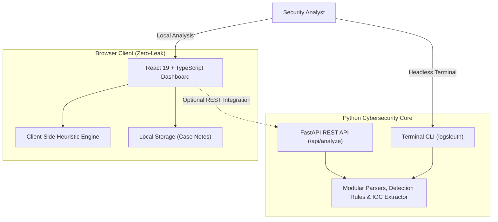

# LogSleuth — Cybersecurity Log Analyzer & SOC Investigation Platform

[](https://logsleuth-cybersecurity-log-analyze.vercel.app)
[](https://fastapi.tiangolo.com)
[](https://react.dev)
[](https://www.typescriptlang.org)
[](https://tailwindcss.com)
[](#testing)
[](LICENSE)

> **LogSleuth** is a defensive cybersecurity log analysis and incident investigation platform designed for SOC analysts, cybersecurity students, and defenders. It ingests diverse log streams, normalizes them into structured events, detects suspicious adversary activity using transparent rule-based heuristics, extracts observables (IOCs), and provides an interactive triage workspace with full client-side privacy.

## 🌐 Live Production Demo

The production application is live, free, and publicly accessible on Vercel:
👉 **[https://logsleuth-cybersecurity-log-analyze.vercel.app](https://logsleuth-cybersecurity-log-analyze.vercel.app)**

- **Zero-Latency Client-Side Processing**: All parsing and detection run locally inside browser memory.
- **Privacy-Preserving**: No logs, tokens, or credentials leave your workstation.
- **Instant Triage**: Four bundled synthetic incident datasets available for one-click analysis without uploading files.
- **Audit-Ready Reporting**: Export findings as JSON/CSV or generate a sanitized Print-to-PDF security report.

---


## 🛡️ Key Features

- **Multi-Format Ingestion**: Native parsing for Linux `auth.log` / `secure`, RFC 3164/5424 Syslog, Apache/Nginx combined access logs, JSON Lines (`jsonl`), and CSV files with an interactive column mapper.
- **Explainable Threat Detection Engine**: 8 modular rules mapped to the **MITRE ATT&CK® Framework** with evidence-strength ratings, recommended SOC actions, and zero black-box claims.
- **Interactive SOC Investigation Workspace**: Track findings by lifecycle status (`New`, `Investigating`, `Resolved`, `False Positive`), record timestamped analyst case notes, and jump directly to supporting raw events.
- **Indicator of Compromise (IOC) Extraction**: Deterministic extraction of IPv4 addresses (with RFC 1918 private/public tagging), domains, URLs, email addresses, and cryptographic hashes (MD5, SHA1, SHA256).
- **Incident Reporting & Sanitized Export**: Generate audit-ready executive summaries with browser Print-to-PDF support, automated credential/token redaction, and multi-format exports (CSV & JSON).
- **Zero-Trust Client-Side Privacy**: All log parsing, heuristic evaluation, and indicator extraction run entirely in the browser memory by default. No logs leave your workstation.
- **Dual-Engine Multi-Language Architecture**: Built with Python 3.13 for core cybersecurity logic, FastAPI REST endpoints, and a standalone CLI tool, paired with a React 19 + TypeScript frontend.

---

## 🏛️ Architecture Overview

LogSleuth is designed with dual-engine parity:



Detailed architecture diagrams and design rationales are documented in [`docs/ARCHITECTURE.md`](docs/ARCHITECTURE.md).

---

## 🔍 Supported Log Formats

| Format | Source Examples | Extracted Attributes |
|---|---|---|
| **Linux Auth Log** | `/var/log/auth.log`, `/var/log/secure` | SSH accepted/failed, invalid users, sudo commands, PAM sessions |
| **Syslog** | `/var/log/syslog`, RFC 3164/5424 | Hostname, process name, PID, severity, facility |
| **Apache Access** | `/var/log/apache2/access.log` (CLF) | Client IP, HTTP verb, path, status code, size, referer, User-Agent |
| **Nginx Access** | `/var/log/nginx/access.log` | Identical to Apache Combined format |
| **JSON Lines (JSONL)**| CloudWatch, Kubernetes, Datadog | Automatic key resolution for timestamps, IPs, users, and levels |
| **CSV Exports** | Windows Event Log CSV, Splunk exports | Automatic column detection + manual field mapping modal |
| **Generic Text** | Custom application logs | Keyword and timestamp-based severity and action extraction |

---

## ⚡ Detection Rules & MITRE ATT&CK Mapping

LogSleuth includes 8 transparent, rule-based detection modules:

1. **`AUTH-001`**: **Brute Force / Repeated Failed Logins** (`T1110.001`) — Detects $\ge 5$ failures from a single IP within 10 minutes.
2. **`AUTH-002`**: **Password Spraying** (`T1110.003`) — Detects failed logins targeting $\ge 3$ distinct accounts from one source.
3. **`AUTH-003`**: **Success After Repeated Failures** (`T1110`) — Flags accepted logins preceded by $\ge 3$ consecutive failures.
4. **`WEB-001`**: **Web Reconnaissance & Directory Scanning** (`T1595.002`) — Detects $\ge 10$ HTTP 404 responses from one client.
5. **`WEB-002`**: **Sensitive Path Access & Path Traversal** (`T1190`) — Detects probes against administrative endpoints and `../` traversal encodings.
6. **`WEB-003`**: **HTTP Authentication Failures** (`T1190`) — Detects $\ge 5$ HTTP 401/403 status codes.
7. **`NET-001`**: **High Request Volume** (`T1498`) — Identifies single-source traffic bursts exceeding 100 requests.
8. **`SYS-001`**: **System Error Burst** (`T1499`) — Detects $\ge 10$ error/critical events within 5 minutes.

Full technical specifications, thresholds, and false-positive considerations are documented in [`docs/DETECTION_RULES.md`](docs/DETECTION_RULES.md).

---

## 📦 Synthetic Demonstration Datasets

Four bundled synthetic datasets are included directly in the application for immediate hands-on investigation:

1. **`auth_normal.log`**: Healthy baseline Linux authentication activity (SSH publickey logins, cron jobs, routine sudo commands) resulting in zero findings.
2. **`auth_bruteforce.log`**: Password spraying across accounts (`root`, `oracle`, `user`, `test`) followed by brute-forcing and compromise of the `admin` account.
3. **`web_recon.log`**: Apache access log with directory enumeration, sensitive file probes (`/.env`, `/.git`, `/phpmyadmin`), and path traversal attempts (`../../etc/passwd`).
4. **`mixed_application.log`**: Production JSONL application telemetry featuring distributed microservice activity and a cascading error burst.

---

## 🚀 Quickstart & Installation

### Prerequisites
- Node.js 18+ and npm
- Python 3.10+ (for Python engine & CLI)

### 1. Running the Frontend (Local Browser Mode)
```bash
cd frontend
npm install
npm run dev
```
Open [http://localhost:5173](http://localhost:5173) in your browser. The application runs immediately in **Zero-Leak Local Privacy Mode**.

### 2. Running the Python Backend & REST API
```bash
cd backend
pip install -e .
uvicorn logsleuth.api:app --reload --port 8000
```
API Documentation (Swagger UI) is available at [http://localhost:8000/docs](http://localhost:8000/docs).

### 3. Using the Headless Python CLI
```bash
# Analyze a log file directly from the terminal
python -m logsleuth.cli backend/logsleuth/samples/auth_bruteforce.log --findings-only

# Filter by minimum severity
python -m logsleuth.cli /path/to/server.log --severity high --output findings.json

# Extract only Indicators of Compromise (IOCs)
python -m logsleuth.cli /path/to/access.log --iocs-only
```

---

## 🧪 Testing & Verification

Both the Python engine and TypeScript frontend are backed by automated test suites (49 total passing tests):

### Run Python Pytest Suite (23 Tests)
```bash
python -m pytest backend/tests -v
```

### Run Frontend Vitest Suite (26 Tests)
```bash
cd frontend
npm test
```

### Production Build Verification
```bash
cd frontend
npm run build
```

---

## 🔒 Security & Privacy Policy

- Log analysis occurs exclusively within local browser memory by default.
- No log entries, indicators, or credentials are sent to external third parties or AI models.
- The reporting engine provides an **Auto-Redact Secrets** toggle that masks passwords, Bearer tokens, and API keys before export.
- Full details in [`docs/SECURITY.md`](docs/SECURITY.md).

---

## 📄 License

This project is open-source under the [MIT License](LICENSE).
