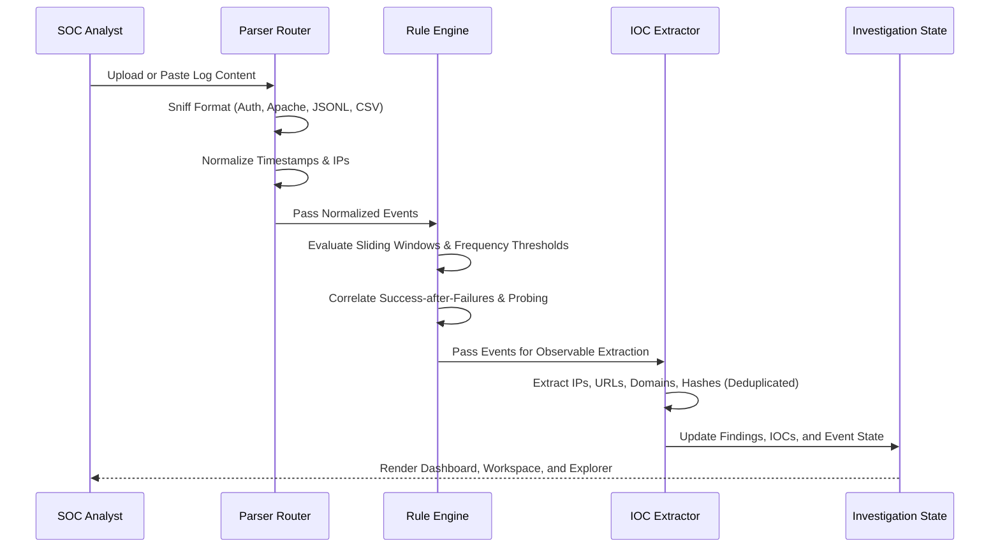

# LogSleuth — Architecture & System Design

LogSleuth employs a **hybrid dual-engine architecture** combining a production-grade Python cybersecurity engine with a high-performance, client-side zero-leak browser analyzer.

---

## 1. High-Level Architecture Diagram

```mermaid
graph TD
    User["Security Analyst / Student"]
    
    subgraph Browser["Browser Client Runtime (Zero-Trust)"]
        UI["React 19 + TypeScript UI\n(Tailwind CSS v4 & Lucide Icons)"]
        State["AnalysisContext State & LocalStorage"]
        ClientEngine["Client-Side Analysis Engine\n(Zero Network Leaks)"]
        
        subgraph ClientPipelines["Client Ingestion & Analysis"]
            CP_Parse["Multi-Format Parser Router"]
            CP_Detect["Modular Rule Engine (AUTH, WEB, NET, SYS)"]
            CP_IOC["Regex IOC Extractor (RFC1918 Aware)"]
            CP_Export["Sanitized CSV & JSON Exporter"]
        end
    end

    subgraph BackendEngine["Python Cybersecurity Engine (FastAPI & CLI)"]
        API["FastAPI REST Endpoints\n/api/analyze & /api/health"]
        CLI["Python CLI Tool\n(logsleuth --findings-only)"]
        
        subgraph PyPipelines["Python Core Package (logsleuth)"]
            PY_Parse["Parsers (auth.log, syslog, apache, jsonl, csv)"]
            PY_Rules["Modular Detection Rules (MITRE ATT&CK Mapped)"]
            PY_IOC["Indicator Extraction & Private IP Classifier"]
            PY_Summary["Telemetry & Timeline Aggregator"]
        end
    end

    User -->|Ingest / Paste / Load Sample| UI
    UI --> State
    State -->|Mode: Local Browser Engine| ClientEngine
    ClientEngine --> CP_Parse --> CP_Detect --> CP_IOC --> CP_Export
    
    State -.->|Mode: Python REST API (Optional)| API
    CLI --> PyPipelines
    API --> PyPipelines
    PY_Parse --> PY_Rules --> PY_IOC --> PY_Summary
```

---

## 2. Core Architectural Principles

### 2.1 Defense-in-Depth Privacy (Zero-Leak)
- By default, all log ingestion, tokenization, regex-based indicator extraction, and sliding-window heuristic detection execute inside the local browser memory.
- No log lines, internal IP addresses, employee usernames, or configuration tokens are transmitted across external networks.
- Full offline capability: Once loaded, the browser client remains fully operational without active Internet connectivity.

### 2.2 Dual-Engine Parity
- **Python Package (`logsleuth`)**: Implements strict object-oriented parsers, Pydantic v2 schemas, and 8 modular detection rules. Accessible via FastAPI endpoints and the standalone `logsleuth` terminal CLI.
- **Client-Side Engine (`src/services/clientEngine/`)**: Implements identical parsing heuristics, timestamp parsing, detection logic, and RFC 1918 classification in native TypeScript.
- Seamless automatic fallback: If the Python backend is unavailable, the UI automatically transitions to the client-side engine with zero disruption to the analyst.

---

## 3. Data Normalization Schema

All parsers normalize raw log entries into a standardized `ParsedEvent` schema:

| Field | Type | Description |
|---|---|---|
| `id` | `string` | Unique UUID per event |
| `timestamp` | `ISO 8601 string` | Standardized UTC timestamp |
| `raw_message` | `string` | Preserved original raw log line |
| `source_ip` | `string \| null` | IPv4 address of the initiating client |
| `destination_ip` | `string \| null` | Target network address |
| `username` | `string \| null` | Authenticated or attempted username |
| `hostname` | `string \| null` | Originating host or server identifier |
| `event_category` | `enum` | `authentication`, `web_access`, `network`, `system`, etc. |
| `event_action` | `string \| null` | `login_failed`, `login_success`, `http_forbidden`, etc. |
| `http_method` | `string \| null` | HTTP request verb (`GET`, `POST`, etc.) |
| `http_path` | `string \| null` | Requested URI resource path |
| `http_status` | `number \| null` | HTTP response code (200, 401, 403, 404, 500) |
| `severity` | `enum` | Normalized severity (`informational`, `low`, `medium`, `high`, `critical`) |
| `is_suspicious` | `boolean` | Flagged if correlated with any detection rule |
| `detection_ids` | `string[]` | Array of rule identifiers triggered by this event |

---

## 4. Detection Pipeline Flow



---

## 5. Deployment Model

- **Static Frontend**: Deployed on Vercel Edge Network (`frontend/dist`), serving compiled React 19 + Vite bundle with CDN caching.
- **Serverless API**: Configured via `vercel.json` and `api/index.py` with Python 3.12 runtime.
- **Local Python CLI / Backend**:
  ```bash
  cd backend
  pip install -e .
  # Run REST API:
  uvicorn logsleuth.api:app --reload
  # Run CLI analysis:
  logsleuth /path/to/logfile.log --findings-only
  ```
